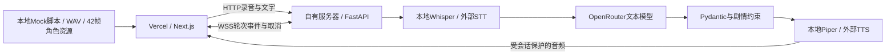

# 雨停之前 · After Rain

移动网页优先的单角色互动短场景。Mira 是 26 岁的原创成年旅行摄影师；雨夜的街角咖啡馆里，你可以用文字或语音与她交流，并在她说话时按住麦克风打断。

前端：Next.js 16 + TypeScript + SWR + Zustand + Tailwind CSS 4。后端：Python 3.12 + FastAPI。单仓库 monorepo，前端部署 Vercel，后端通过 GitHub Actions + SSH 部署自有服务器。

## 先体验，无需密钥

要求 Node.js 22.13+（22系列）或24+与 Corepack；仓库已经包含 Mock 音频与原创 SVG 序列帧，不需要下载模型。

```bash
corepack pnpm install --frozen-lockfile
corepack pnpm dev
```

打开终端打印的地址（默认 `http://localhost:3000`，端口占用时 Next.js 会选择其他端口）。进入场景后，顶部 **Mock 开关默认开启**。

- Mock 的文字输入按当前内容选择预设回应；照片、雨窗、等待朋友等话题分别触发不同表情和演出。
- **按住演示**模拟倾听，立即停止旧语音；松开后使用预设问题“窗外的雨停了吗？”。Mock 不申请麦克风权限、不识别真实语音、不上传数据。
- “体验说明”中可以注入一次语音失败，随后重新发送即可恢复。
- 关闭 Mock 后才会建立真实后端会话；缺少接口配置会明确报错，绝不悄悄返回预设文本冒充模型。

也可在已安装 Docker 的环境一条命令启动前后端（默认仍使用前端 Mock）：

```bash
docker compose -f infra/compose.yml up --build
```

首次 Docker 构建依赖网络；免费真实语音另需下载模型，下载不属于免密钥 Mock 的必要步骤。清洁环境 15 分钟启动目前尚未完成实测。

## 接入真实后端

### 1. 安装与配置

```bash
cd apps/api
uv sync --frozen --extra local --python 3.12
cp .env.development.example .env.development
```

在 `apps/api/.env.development` 填入自己的 `OPENROUTER_API_KEY` 与 `OPENROUTER_MODEL`；模型 ID 由部署者决定。默认非流式调用 OpenRouter，JSON 提示词 + Pydantic 校验；若选择支持严格 JSON Schema 的模型，可启用 `OPENROUTER_STRUCTURED=true`。

`.env.development` 中的 `ALLOWED_ORIGINS` 必须包含前端实际地址，端口也要一致；默认例子包含 3000、3002。API 还需要系统安装 FFmpeg。

### 本地与生产配置规则

本地实际使用 `apps/api/.env.development`，仓库仅提交 `.env.development.example`。首次克隆复制示例；已有文件不要覆盖。字段与生产 GitHub Actions 配置一致，本地 CORS 使用 localhost 地址，模型密钥/模型 ID 填真实值。

默认 `APP_ENV=development`，配置顺序为类默认值 → `apps/api/.env` → `apps/api/.env.development` → 系统环境变量。可通过进程环境 `APP_ENV=production` 选择 `.env.production`。修改 dotenv 后需要重启后端。配置目录固定在 `apps/api`，不依赖启动命令当前目录；相对 Piper 模型路径也按后端目录解析。

生产设置 `APP_CONFIG_FILE` 后只读取服务器只读 JSON，不读取本地 dotenv；它由 GitHub Secrets/Variables 生成。`/api/health` 返回 environment 和配置就绪标志，不返回密钥。

### 2. 准备免费的本地语音

从仓库根目录运行：

```bash
MODEL_DIR="$PWD/models" apps/api/.venv/bin/python scripts/prepare_models.py
```

如官方模型站不可达，可以自行选择可信镜像，通过 `HF_ENDPOINT=https://hf-mirror.com` 配置。默认 Whisper tiny 做中文识别，Piper huayan medium 做中文非实时 TTS。文件下载一次后缓存；模型不提交到 Git。示例音色的上游模型卡将训练数据许可标为 Unknown，不能将其宣传为已经获得商用授权，详见 `THIRD_PARTY.md`；可换成你有许可的 Piper ONNX 音色或外部 TTS。

默认本地模型没有按次 API 费用，仍消耗服务器 CPU/内存。语音风格与准确率受模型限制；Whisper tiny 适合低成本功能验证，需要更好的中文识别时可将 `WHISPER_MODEL` 改为 `base` 或 `small` 并重新准备模型。OpenRouter 是否收费取决于所选模型和账号，免费模型也可能有额度/速率限制。

### 3. 启动

```bash
# 终端一，在仓库根目录；自动读取 apps/api/.env.development
corepack pnpm dev:api

# 终端二，在仓库根目录
cp apps/web/.env.example apps/web/.env.local
corepack pnpm dev
```

前端 `NEXT_PUBLIC_API_URL` 只填写后端 origin，例如 `http://localhost:8000` 或 `https://api.example.com`，不包含 `/api`。修改它后重新启动/构建前端。**所有 `NEXT_PUBLIC_*` 都是公开信息，不得放模型密钥。**

关闭 Mock 后建立 HTTP + WebSocket 连接。真实语音为按住录音，松开提交（最多 20 秒）；手机访问需要可信 HTTPS。后端转码 → STT → OpenRouter → JSON 校验 → TTS → 音频就绪事件，浏览器开始播放时同步显示整条回复字幕。不是全双工实时语音，也没有逐字口型/字幕。

### 替换模型服务

配置相互独立，见 `apps/api/.env.example`：

| 部分 | 免费本地路径 | 可扩展外部路径 |
|---|---|---|
| LLM | 可选 Ollama，`LLM_PROVIDER=ollama` | 默认 OpenRouter；也支持 `compatible` 文本接口 |
| STT | `STT_PROVIDER=local`，faster-whisper CPU int8 | `compatible`，`POST {STT_BASE_URL}/audio/transcriptions` multipart |
| TTS | `TTS_PROVIDER=local`，Piper，输出 WAV | `compatible`，`POST {TTS_BASE_URL}/audio/speech`，请求 WAV |
| 字幕 | 已有回复文本，无额外费用 | 同样无需字幕 API |

这里的 compatible 指文档中列出的协议形状，不表示所有厂商的私有协议都能直接接入；例如返回异步任务 ID 或不同 JSON 音频字段的服务需要新增适配。OpenRouter 只承担本项目的文本 LLM，不假定它统一提供 STT/TTS。

## 架构与打断

实际代码遵循后端 MVC/Service/Repository 分层，前端 Feature 组件 + services 业务 Hook 分层。维护说明与目录见 [工程架构规范](docs/工程架构规范.md)。



- Zustand 保存角色 phase/emotion/action/environment 等状态；SWR 读取后端健康状态，useSWRMutation 创建会话；生成回复由用户命令触发，不走 GET 自动重验证。
- 前端 TurnGate 管理 epoch/turn，任何新输入先立即停音、清字幕与动作，递增轮次，再请求服务端取消。
- HTTP 请求、WebSocket 事件、音频下载、onplaying/onended、录音权限回调均检查当前轮次。旧响应不能重新播放，也不能把新一轮倾听改回待机。
- 服务端按 session + epoch + turn 校验，取消旧 asyncio 任务；外部服务不支持取消时丢弃结果，仍可能产生上游费用。本地 CPU 推理线程也不能瞬间终止，但不会获得播放资格。
- 会话历史在收到播放结束确认后提交；已开始而被打断的回复标为可能未听完。未播放内容不写入已完成历史。
- 原始录音在临时文件中解码后删除；生成音频仅在内存保留当前轮，会话 30 分钟空闲过期。重启丢失会话，只运行单 API worker。

结构化指令：

```json
{"text":"给你看看这张照片。","emotion":"curious","action":"offer_photo","environment":"cafe_night","event":"reveal_photo"}
```

有限枚举与本地素材 ID 映射。模型不能给任意 URL 或执行脚本；照片事件需当前输入涉及照片/摄影，雨窗变化需当前输入涉及雨/窗。正文和帧动画在语音开始播放时生效。协议说明见 `packages/contracts/README.md`。

## 验证与交付状态

```bash
corepack pnpm check  # 格式、ESLint、类型、测试、生产构建
cd apps/api && uv run --frozen pytest -q
```

本次本地已验证：Next.js 生产构建、Mock 音频可加载、9 项前端测试、19 项后端测试、桌面浏览器文字/音频/照片事件以及输入框聚焦样式。后端测试使用确定性的模拟模型服务和 HTTP transport，**不代表已经调用真实 OpenRouter**。

本地免费 STT/TTS 已实际验证通过（Piper → WAV → FFmpeg → Whisper），中文人名仍可能识别不准。可复现：

```bash
HF_HOME="$PWD/models/huggingface" apps/api/.venv/bin/python scripts/smoke_speech.py
```

真实 OpenRouter 端到端、Vercel 公网、目标服务器部署、iOS/Android 真机与 3–5 分钟最终录屏，需在填入真实配置后继续验收。Docker 容器构建尚需可用的 Docker daemon，不将仅通过 Compose 配置检查视为容器已运行。完整脚本见 `docs/验收与演示.md`。

### 已知限制与明确不做

单角色、单场景、内存会话、有限话题 Mock、回复级字幕、按住说话。错误显示后可重试，断线后手动创建新会话；不做自动无损恢复。模型 JSON 不合法时提示重试，不执行不可信指令；没有额外模型格式修复调用。

不实现账号、支付、后台、市场/社区、原生客户端、模型训练、多角色/多章节、大规模基础设施。也不做自动 VAD、附和词判断、口型同步、实时生成图片/视频、观测页面和通用回放平台。

与初步方案的调整：按用户要求改成 Vercel + 自有服务器分离部署；文本模型使用 OpenRouter；语音优先免费本地推理；Mock 语音不访问硬件；HTTP/WS 契约以实现为准。候选整套开源产品未完成本机运行验证，不声称已经通过复用门槛；本版本复用 Next.js/FastAPI/faster-whisper/Piper 等组件，自行实现题目核心的轮次与场景编排，没有复制候选产品的前端。

### 投入时间与两周演进

当前为 AI 辅助实现阶段，未采集开发者实际有效工时；原评估为 44–60 小时，**不能把预算当成实际投入**。交付者录屏前应补充自己的实际工作记录。

如继续两周：先完成目标真机与真实服务验收、替换/明确许可的正式音色、测量实际阶段耗时；根据反馈再考虑自然 VAD、逐句语音与字幕。其余题目排除项仍不纳入这份 MVP。

部署配置见 **[部署指南](docs/部署指南.md)**，AI 工具参与记录见 **[AI_USAGE.md](AI_USAGE.md)**，素材与依赖来源见 **[THIRD_PARTY.md](THIRD_PARTY.md)**。
