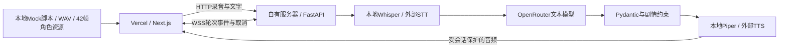

# 雨停之前 · After Rain

Mira 是 26 岁的原创成年旅行摄影师；雨夜的街角咖啡馆里，你可以用文字或语音与她交流，并在她说话时按住麦克风打断。

前端：Next.js 16 + TypeScript + SWR + Zustand + Tailwind CSS 4

后端：Python 3.12 + FastAPI。单仓库 monorepo，前端部署 Vercel，后端通过 GitHub Actions + SSH 部署自有服务器。

## 项目背景

### 题目来源与产品目标

本项目基于题目文档《72 小时实验：实时互动场景产品》（`0912-candidate(1).pdf`）设计与实现。题目要求以架构师视角，在收到题目后的 72 小时提交窗口内完成方案设计和 MVP，将文字、语音、角色表演以及多模态内容整合成一个可运行的前后端互动闭环。

产品以移动端网页体验为优先：用户面对的是具体环境中的角色，页面以背景、角色和字幕为视觉主体，配合文字输入和麦克风入口。核心目标是让用户通过画面感知角色正在倾听、思考或说话，并让当前对话推动表情、动作与场景变化，支撑一次连续的 3–5 分钟互动。

### 故事与体验设定

“雨停之前 · After Rain”采用题目提供的故事种子：暴雨后的夜晚，用户在一家即将打烊的咖啡馆遇见 Mira。她是一名 26 岁的旅行摄影师，穿着琥珀色雨衣，戴着银色星星发夹，似乎在等待某个人，却不愿直接说明原因。

项目围绕这位原创成年角色展开短场景体验。用户可以从雨夜、旅行、照片或等待的话题切入；角色通过语音和字幕回应，并结合交流内容展现情绪、展示照片或触发雨窗等环境变化。剧情用于承载互动，让用户能够观察到“输入内容 → 角色回应 → 画面变化”的因果关系。

### 核心要求与实现方向

| 题目要求 | 本项目的实现方向 |
| -------- | ---------------- |
| 场景化页面，适配移动端并兼容桌面端；至少有待机、倾听、思考、说话四种状态 | 以咖啡馆背景和 Mira 为主体，通过角色动画、字幕和交互入口表达当前状态 |
| 文字与麦克风输入、语音回复、同步字幕和连续多轮对话 | 使用 STT → 文本模型 → TTS 链路，浏览器开始播放回复时显示整条字幕 |
| 用户能在角色说话时打断，旧回复及其字幕、动作和媒体事件立即停止或失效 | 提供按住说话交互，并通过会话轮次校验与取消机制阻止迟到响应重新播放；真实模式另提供连续语音入口 |
| 至少 3 种可辨认情绪或表情、2 种非说话动作或视觉状态、1 次环境变化，以及 1 个由当前对话触发的明显视觉事件 | 以结构化回复中的情绪、动作、环境和事件字段驱动本地资源，将照片和雨窗演出与对话内容关联 |
| 至少集成一种角色动画、视频或生成式媒体能力 | 选择原创 SVG 序列帧角色动画，作为本项目的多模态表现路径 |
| 前后端与模型调用形成闭环，对超时、断线和媒体失败提供反馈，并支持无私人密钥体验 | 真实模式接入模型服务；Mock 模式提供预设回应、本地音频和角色演出，便于独立体验核心流程 |

以上是题目要求与实现方向的对应关系，具体已验证内容、待验收项和已知限制见下文“验证与交付状态”。题目允许端到端语音模型或 STT / LLM / TTS 组合，也允许按住说话或点击打断；本项目采用分阶段语音链路和明确的按住交互，便于独立替换服务、定位失败阶段，并让打断时机可控。

### MVP 范围与交付原则

本次 MVP 聚焦单角色、短场景、多轮交流、角色演出和可靠打断。题目列出的自然语音活动检测、口型同步、流式字幕、生成式图片或视频、会话恢复及观测页面属于可选扩展；具体是否实现以下文说明为准。账号、支付、后台、角色市场、原生客户端、模型训练、多角色长篇内容和大规模生产基础设施不在本次范围内。

题目同时强调可复现交付：提供源码、演示地址或清晰的本地启动说明，优先支持一条命令启动，否则完整启动过程应可在 15 分钟内完成；录制 3–5 分钟演示，覆盖互动、角色变化、打断、多模态表现和至少一种失败或降级状态。README 记录架构、技术取舍、第三方来源、已知问题、投入时间与后续计划，`AI_USAGE.md` 记录 AI 工具参与情况和验证过程。当前项目的本地启动步骤如下，录屏及真实服务验收状态见后文，不将交付目标视为已完成验证。

## 本地启动：从克隆到前后端联调

首次启动请按顺序完成：**克隆项目 → 复制并填写环境配置 → 安装依赖 → 下载语音模型 → 启动前后端 → 关闭 Mock 验证真实接口**。不要复制完配置就直接启动：后端示例里的 `OPENROUTER_API_KEY` 和 `OPENROUTER_MODEL` 都是空值，需要手动填写。

以下命令适用于 macOS / Linux 的 Bash 或 Zsh；Windows 建议在 WSL2 中执行，当前后端启动脚本使用 POSIX 环境变量语法和 `env -u`。除特别说明外，所有命令都在仓库根目录执行。

### 1. 准备运行环境

| 工具 | 要求 / 用途 |
| ---- | ----------- |
| Git | 克隆仓库 |
| Node.js | 22.13+（22 系列）或 24+，与根目录 `package.json` 一致；`.nvmrc` 指定 22 系列 |
| Corepack / pnpm | 使用 `corepack pnpm`，仓库固定 pnpm 10.33.4 |
| uv / Python | 使用 uv 安装后端依赖；启动脚本指定 Python 3.12 |
| FFmpeg | 真实语音录音转码，需安装到系统并能在终端中调用 |

macOS 已安装 Homebrew 时，可用 `brew install uv ffmpeg` 安装这两个工具。Node.js 安装后若没有 Corepack，可执行 `npm install -g corepack`；以下命令均通过 `corepack pnpm` 调用，无需另外全局安装 pnpm。Python 3.12 可用 `uv python install 3.12` 安装。

```bash
git --version
node --version
corepack --version
uv --version
ffmpeg -version
```

首次安装依赖和下载模型需要联网；真实对话还需要后端能访问 OpenRouter。

### 2. 克隆项目

```bash
git clone https://github.com/maicFir/CharacterInteraction.git
cd CharacterInteraction
```

如果已经克隆，直接进入现有仓库目录即可。

### 3. 先复制并填写环境配置

首次克隆后，从仓库根目录复制前后端各自的示例配置。**已有 `.env.development` 时不要重复覆盖，请对照示例补齐缺失项。**

```bash
cp apps/api/.env.development.example apps/api/.env.development
cp apps/web/.env.development.example apps/web/.env.development
```

打开 `apps/api/.env.development`，至少填写以下两项，其他字段先保留示例值：

```dotenv
OPENROUTER_API_KEY=替换为你自己的OpenRouter_API_Key
OPENROUTER_MODEL=openrouter/free
```

`OPENROUTER_API_KEY` 必须替换为真实密钥，不能保留上面的占位文字；`OPENROUTER_MODEL` 请明确填写 `openrouter/free` 或你要使用的文本模型 ID。不要把密钥写到前端配置中，也不要提交到 Git。

前端 `apps/web/.env.development` 保留默认代理目标即可：

```dotenv
DEV_API_PROXY_TARGET=http://127.0.0.1:8000
```

后端的 `ALLOWED_ORIGINS` 必须包含浏览器实际访问的前端地址，协议、主机名和端口都要一致。示例已包含 `http://localhost:3002`，建议本地统一使用这个地址；若改用 `http://127.0.0.1:3002`，需要把它加入允许列表。

### 4. 安装前后端依赖

确认配置填写完成后，在仓库根目录执行：

```bash
corepack pnpm install --frozen-lockfile
uv sync --project apps/api --frozen --extra local --python 3.12
```

后端依赖安装到 `apps/api/.venv`，不需要手动激活虚拟环境。`--extra local` 会安装默认本地 STT/TTS 所需依赖，不要省略。

### 本地与生产配置规则

本地实际使用 `apps/api/.env.development`，仓库仅提交 `.env.development.example`。首次克隆复制示例；已有文件不要覆盖。字段与生产 GitHub Actions 配置一致，本地 CORS 使用 localhost 地址，模型密钥/模型 ID 填真实值。

默认 `APP_ENV=development`，配置顺序为类默认值 → `apps/api/.env` → `apps/api/.env.development` → 系统环境变量。可通过进程环境 `APP_ENV=production` 选择 `.env.production`。修改 dotenv 后需要重启后端。配置目录固定在 `apps/api`，不依赖启动命令当前目录；相对 Piper 模型路径也按后端目录解析。

生产设置 `APP_CONFIG_FILE` 后只读取服务器只读 JSON，不读取本地 dotenv；它由 GitHub Secrets/Variables 生成。`/api/health` 返回 environment 和配置就绪标志，不返回密钥。

### 5. 准备免费的本地语音

默认配置使用 Whisper 识别语音、Piper 生成回复语音；**真实文字输入也会生成语音回复，因此完整联调前同样需要准备模型**。从仓库根目录运行，等待下载成功后再启动服务：

```bash
MODEL_DIR="$PWD/models" apps/api/.venv/bin/python scripts/prepare_models.py
```

如官方模型站不可达，可以自行选择可信镜像，通过 `HF_ENDPOINT=https://hf-mirror.com` 配置。默认 Whisper tiny 做中文识别，Piper huayan medium 做中文非实时 TTS。文件下载一次后缓存；模型不提交到 Git。后端通过 `WHISPER_DOWNLOAD_ROOT` 读取缓存，实际请求期间不自动下载模型；缺失时提示先准备模型。示例音色的上游模型卡将训练数据许可标为 Unknown，不能将其宣传为已经获得商用授权，详见 `THIRD_PARTY.md`；可换成你有许可的 Piper ONNX 音色或外部 TTS。

默认本地模型没有按次 API 费用，仍消耗服务器 CPU/内存。语音风格与准确率受模型限制；Whisper tiny 适合低成本功能验证，需要更好的中文识别时可将 `WHISPER_MODEL` 改为 `base` 或 `small` 并重新准备模型；本地准备命令也要传入同样的 `WHISPER_MODEL` 值，例如 `WHISPER_MODEL=small MODEL_DIR="$PWD/models" apps/api/.venv/bin/python scripts/prepare_models.py`。OpenRouter 是否收费取决于所选模型和账号，免费模型也可能有额度/速率限制。

模型准备脚本不会自动读取 `.env.development`；上面的命令与示例默认模型匹配。如果修改了 `WHISPER_MODEL`，需要像上例一样给下载命令显式传入相同值。默认文件保存在根目录 `models/` 下，包含 Whisper 缓存，以及 Piper 的 `.onnx` 和 `.onnx.json` 文件。

### 6. 最后启动前后端

完成配置、依赖安装和模型下载后，选择以下一种启动方式，不要重复启动同一服务。

**方式一：一个终端同时启动（推荐）**

```bash
corepack pnpm dev:local
```

按 `Ctrl+C` 会一起停止前后端。如当前环境不支持 Turbopack，可使用 `corepack pnpm dev:local --webpack`。

**方式二：两个终端分别启动**

```bash
# 终端一：在仓库根目录启动后端，自动读取 apps/api/.env.development
corepack pnpm dev:api
```

```bash
# 终端二：在仓库根目录启动前端
corepack pnpm dev:web
```

分别启动时，在两个终端中各按一次 `Ctrl+C` 停止。根目录 `corepack pnpm dev` 仅启动前端；需要同时启动前后端请使用 `dev:local`。

### 7. 检查服务并体验真实对话

- 前端：`http://localhost:3002`。
- 后端健康检查：`http://127.0.0.1:8000/api/health`。
- 前端代理健康检查：`http://localhost:3002/backend/api/health`。
- 后端接口文档：`http://127.0.0.1:8000/docs`。

也可在另一个终端检查：

```bash
curl --fail http://127.0.0.1:8000/api/health
curl --fail http://localhost:3002/backend/api/health
```

健康检查中的 `environment` 应为 `development`，配置密钥后 `llm_configured` 应为 `true`。它仅说明配置状态，不代表密钥有效、模型可用或语音链路已验证。

进入场景后，顶部 **Mock 开关默认开启**；关闭 Mock 才会连接真实后端。先发送一条文字，确认模型回复和音频正常，再授权麦克风测试语音。关闭 Mock 后点击顶部“模型”可选择模型；切换会中断当前回复、创建新会话并清空当前对话。文本模型选择不改变 STT/TTS。

本地开发由 Next.js 将同源 `/backend/*` 代理到 `DEV_API_PROXY_TARGET`（默认 `http://127.0.0.1:8000`），HTTP 与 WebSocket 都走代理。生产构建不注册此规则；生产 `NEXT_PUBLIC_API_URL` 填后端 origin，例如 `https://api.example.com`，不包含 `/api`。修改配置后重新启动/构建前端。**所有 `NEXT_PUBLIC_*` 都是公开信息，不得放模型密钥。**

关闭 Mock 后建立 HTTP + WebSocket 连接。真实语音为按住录音，松开提交（最多 20 秒）；手机访问需要可信 HTTPS。后端转码 → STT → OpenRouter → JSON 校验 → TTS → 音频就绪事件，浏览器开始播放时同步显示整条回复字幕。不是全双工实时语音，也没有逐字口型/字幕。

### 注意事项与常见问题

| 现象 | 排查方法 |
| ---- | -------- |
| 页面正常，但回复始终是预设内容 | 检查 Mock 是否关闭；Mock 不调用真实后端 |
| 提示未配置模型，或 OpenRouter 鉴权失败 | 检查后端 `.env.development` 中的密钥和模型 ID，修改后重启后端；健康检查不会验证密钥有效性 |
| 模型不可用、限流或回复超时 | 检查账号权限、额度、模型 ID 和后端网络；免费模型也可能有限流，模型可用性以实际调用为准 |
| 提示缺失语音模型 / FFmpeg | 确认模型下载成功、模型路径与配置一致，且 `ffmpeg -version` 可执行；只有文本模型密钥不足以完成默认语音链路 |
| 代理报错或连接被拒绝 | 先检查后端直连健康接口，再检查代理健康接口；确认后端已启动且 `DEV_API_PROXY_TARGET` 与监听地址一致 |
| WebSocket 来源校验失败 | 检查后端 `ALLOWED_ORIGINS` 是否包含当前前端 origin；`localhost` 和 `127.0.0.1` 是不同来源 |
| 端口占用（3002 / 8000） | 停止自己先前启动的项目进程，再重新启动；不要同时运行 `dev:local` 和单独启动命令 |
| 修改配置后无变化 | 重启对应服务；系统环境变量会覆盖后端 dotenv，前端已有 `.env.local` 也可能覆盖 `.env.development` 中的代理目标 |
| 手机无法录音 | 手机访问需要可信 HTTPS 和麦克风授权；手机的 localhost 指向手机自身，默认后端仅监听本机，局域网联调需另行配置代理与允许来源 |

默认 OpenRouter 调用为非流式，使用 JSON 提示词和 Pydantic 校验；仅在选择支持严格 JSON Schema 的模型时启用 `OPENROUTER_STRUCTURED=true`。本地配置文件及模型目录已被 `.gitignore` 忽略，提交前仍应检查没有意外加入密钥。

## 仅体验 Mock（可选，无需后端或密钥）

完成运行环境准备和克隆后，只需安装前端依赖并启动：

```bash
corepack pnpm install --frozen-lockfile
corepack pnpm dev:web
```

打开 `http://localhost:3002` 并保持 Mock 开启。此路径无需 Python、FFmpeg、OpenRouter 密钥或语音模型；仓库已包含 Mock 音频与原创 SVG 序列帧。

- 文字输入按当前内容选择预设回应；照片、雨窗、等待朋友等话题分别触发不同表情和演出。
- “按住演示”模拟倾听，立即停止旧语音；松开后使用预设问题“窗外的雨停了吗？”。不申请麦克风权限、不识别真实语音、不上传数据。
- “体验说明”中可以注入一次语音失败，随后重新发送即可恢复。
- 关闭 Mock 后需要完成上面的真实后端配置，不会自动用预设文本替代模型回复。

已安装 Docker 时，也可执行 `docker compose -f infra/compose.yml up --build` 启动容器，并访问 `http://localhost:3000` 体验 Mock。该 Compose 配置不会自动加载宿主机的 `.env.development`，不能替代上面的真实后端配置流程。停止容器用 `docker compose -f infra/compose.yml down`。首次构建需要联网；容器构建和清洁环境 15 分钟启动尚未完成实测。

### Mock 演示前准备

1. 按上面的命令启动前端，打开页面，确认顶部 **Mock 已开启**。
2. 使用默认“雨停之前 / Mira”场景，点击 **“坐下来，聊一会儿”** 进入。下面的完整演示优先使用此场景，因为它带有本地录制语音。
3. 打开设备声音，确认页面未静音。若浏览器提示需要点击才能播放，点击错误提示旁的 **“继续播放”**。
4. 若此前切换过场景，打开齿轮“场景设置”，选择“雨停之前”，预览后点击 **“应用场景”**。应用场景会清空当前对话；刷新页面也会恢复默认场景。

Mock 使用本地预设文本、音频和视觉资源，不调用后端或大模型。以下例句可直接复制到文字输入框逐条发送，也可以使用页面提供的对应话题建议。除演示打断外，建议每轮播放结束后再发下一句，方便观察完整效果。

### 默认 Mira 场景：可直接使用的对话示例

| 演示目的 | 输入示例 | 预期回复内容 | 预期画面表现 |
| -------- | -------- | ------------ | ------------ |
| 问候与基础闭环 | `你好，可以坐这里吗？` | Mira 自我介绍，邀请你坐下，提到温热的咖啡 | 平静表情；经历思考、说话状态，显示字幕并播放语音，结束后回到待机 |
| 等待与情绪变化 | `你在等谁？` | 她在等一位很久没见的朋友，不确定对方会不会来 | 切换为忧伤表情；这条回复虽然提到照片，但不会自动弹出照片 |
| 照片与明显视觉事件 | `能看看你的照片吗？` | 介绍去年在海边拍下的照片，以及雨后落在海面的光 | 好奇表情、展示照片动作，并出现照片卡片 |
| 雨窗与环境变化 | `窗外的雨停了吗？` | 描述雨敲窗的声音，邀请你再等一会儿 | 望向窗外动作，切换到雨窗环境状态 |
| 旅行故事 | `你有什么旅行故事？` | 讲述海边小城的人在雨天坐在屋檐下喝茶 | 好奇表情，播放旅行主题回复；不会仅因回复提到海边就展示照片 |
| 告别与收尾 | `谢谢你，晚安。` | 感谢陪伴、提醒路上小心并约定下次再见 | 平静表情，播放告别语音，结束后回到待机；不会自动退出页面 |

默认场景的匹配规则按以下顺序执行，**命中第一类后就返回对应预设**：

| 优先级 | 输入中包含的关键词（任意一个） | 返回的预设 |
| ------ | -------------------------------- | ---------- |
| 1 | 照片、摄影、相机、拍照、photo、camera | 展示照片 |
| 2 | 雨、窗、rain、window | 雨窗 |
| 3 | 等谁、等人、朋友、难过、伤心、等待 | 等待朋友 |
| 4 | 旅、海、哪里、故事 | 旅行 |
| 5 | 再见、谢谢、晚安 | 告别 |
| 未命中 | 例如 `你好` 或 `今天吃什么？` | 默认问候 |

英文关键词不区分大小写。例如 `雨中的照片` 同时包含照片和雨，会优先展示照片；`谢谢你陪我看雨` 会命中雨窗，而不是告别。为了稳定演示，建议一次只使用一个主题。Mock 不理解上下文，相同输入会得到相同预设；要触发视觉事件，需要在当前输入中包含相应关键词，不能仅发送“给我看看”并期待它理解上一轮。

### 示例：演示语音打断与旧回复失效

1. 发送 `能看看你的照片吗？`，等待 Mira 开始说话并出现照片。
2. **在语音尚未播完时按住“按住演示”**，保持约 1–2 秒。
3. 观察旧语音立即停止，页面进入倾听状态，上一轮字幕和角色动作被清理。已展示的照片卡片可能暂时保留，直到下一条回复更新画面。
4. 松开按钮。默认场景会自动提交预设问题 `窗外的雨停了吗？`，随后播放雨窗回复，并显示对应字幕和望窗动作。
5. 等待几秒，确认被打断的照片回复不会重新播放或覆盖当前字幕。

这段操作不需要真的说话，也不会弹出麦克风授权。Mock 中松开按钮提交的是预设问题，不是语音识别结果；它展示的是交互状态和打断机制，不能用于验证真实 STT。按住操作最长 20 秒会自动结束，演示时无需长按到上限。

也可以演示文字打断：先发送 `能看看你的照片吗？`，在回复播放期间再发送 `你在等谁？`，应停止照片回复并切换到等待朋友的回复。若要观察快速连续输入，可在第一条仍处于思考状态时发送第二条，确认只有最新一轮继续输出。

### 示例：演示一次失败与恢复

1. 进入场景后，点击顶部 **“查看体验说明”**。
2. 点击 **“测试一次语音失败与恢复”**。该按钮仅在 Mock 开启且已进入场景时出现。
3. 弹窗关闭后，系统会自动提交一次 `你好`，并显示：`模拟：语音服务暂时不可用。画面仍保留，可以重新发送。` 无需额外发送一句话来触发错误。
4. 点击错误提示旁的 **“重试”**，会重新发送本次 `你好` 并正常播放问候回复；也可以手动发送 `能看看你的照片吗？`，确认新的互动恢复正常。

失败注入仅影响一次回复，无需重启前端。它用于展示错误反馈与恢复入口，不代表发生了真实后端或网络故障。为了完整展示，点击失败按钮后先等待错误出现，再进行下一步操作。

### 示例：切换其他 Mock 场景

打开齿轮“场景设置”，选择下列预设，核对预览后点击“应用场景”，再进入新场景。场景切换会更新背景、角色设定和页面文案，并清空当前对话。

| 场景与角色 | 问候示例 | 故事示例 | 照片事件示例 |
| ---------- | -------- | -------- | ------------ |
| 书页之间 · 林舟（旧书店店主） | `你好` | `能讲讲你的故事吗？` | `那张明信片写了什么？` |
| 下一站微光 · 夏澄（列车乘务员） | `你好` | `你在等什么消息？` | `沿途最美的风景是什么？` |

这两个场景各有三类预设回复：输入包含 `照片 / 明信片 / 风景 / photo` 时优先展示照片；否则包含 `等 / 故事 / 消息 / 信 / 谁` 时使用带忧伤情绪的故事回复；其余输入使用平静的问候。默认 Mira 的六类回复表不适用于这两个场景。

其他场景使用设备提供的**本地中文语音**；若设备没有可用音色，仍会显示字幕和画面变化，但不会播放角色语音。需要稳定展示有声打断时，请使用默认 Mira 场景。其他场景的“按住演示”松开后会发送该场景的第一个建议话题。Mock 只支持选择已有场景预设，编辑“场景提示文案”不会调用模型生成新场景。

### 建议的 3–5 分钟演示顺序

| 时间参考 | 操作 | 展示重点 |
| -------- | ---- | -------- |
| 0:00–0:30 | 展示 Mock 开关并进入默认场景 | 无密钥体验、场景与角色主体、文字和语音入口 |
| 0:30–1:15 | 依次发送问候和 `你在等谁？` | 多轮交流、思考/说话/待机状态、平静与忧伤表情 |
| 1:15–2:00 | 发送照片问题，观察完整回复；再发送一次照片问题并按住打断，松开后进入雨窗回复 | 照片事件、好奇表情、打断、倾听、环境变化 |
| 2:00–2:45 | 打开体验说明，触发一次语音失败并点击“重试” | 错误提示、场景保留、恢复入口 |
| 2:45–3:30 | 发送旅行问题，再以 `谢谢你，晚安。` 收尾 | 主题变化和完整结束一轮互动 |
| 3:30–5:00（可选） | 切换书店或车站，发送表中的故事和照片示例 | 场景预设、角色文案变化、设备语音或字幕降级 |

时间仅为录屏节奏参考，可加入操作讲解。演示中请明确说明当前为 Mock，真实模型回复、麦克风识别、后端网络异常和端到端延迟需要关闭 Mock、完成后端配置后另行验证。

### 替换模型服务

配置相互独立，见 `apps/api/.env.example`：

| 部分 | 免费本地路径                                  | 可扩展外部路径                                                     |
| ---- | --------------------------------------------- | ------------------------------------------------------------------ |
| LLM  | 可选 Ollama，`LLM_PROVIDER=ollama`            | 默认 OpenRouter；也支持 `compatible` 文本接口                      |
| STT  | `STT_PROVIDER=local`，faster-whisper CPU int8 | `compatible`，`POST {STT_BASE_URL}/audio/transcriptions` multipart |
| TTS  | `TTS_PROVIDER=local`，Piper，输出 WAV         | `compatible`，`POST {TTS_BASE_URL}/audio/speech`，请求 WAV         |
| 字幕 | 已有回复文本，无额外费用                      | 同样无需字幕 API                                                   |

这里的 compatible 指文档中列出的协议形状，不表示所有厂商的私有协议都能直接接入；例如返回异步任务 ID 或不同 JSON 音频字段的服务需要新增适配。OpenRouter 只承担本项目的文本 LLM，不假定它统一提供 STT/TTS。

## 架构与打断

实际代码遵循后端 MVC/Service/Repository 分层，前端 Feature 组件 + services 业务 Hook 分层。维护说明与目录见 [工程架构规范](docs/工程架构规范.md)。



- Zustand 保存角色 phase/emotion/action/environment 等状态；SWR 读取后端健康状态，useSWRMutation 创建会话；生成回复由用户命令触发，不走 GET 自动重验证。
- 前端 TurnGate 管理 epoch/turn，任何新输入先立即停音、清字幕与动作，递增轮次，再请求服务端取消。
- HTTP 请求、WebSocket 事件、音频下载、onplaying/onended、录音权限回调均检查当前轮次。旧响应不能重新播放，也不能把新一轮倾听改回待机。
- 服务端按 session + epoch + turn 校验，取消旧 asyncio 任务；外部服务不支持取消时丢弃结果，仍可能产生上游费用。本地 CPU 推理线程也不能瞬间终止，但不会获得播放资格。
- 会话历史在收到播放结束确认后提交；已开始而被打断的回复标为可能未听完。未播放内容不写入已完成历史。
- 原始录音在临时文件中解码后删除；生成音频仅在内存保留当前轮，会话 30 分钟空闲过期。重启丢失会话，只运行单 API worker。

结构化指令：

```json
{
  "text": "给你看看这张照片。",
  "emotion": "curious",
  "action": "offer_photo",
  "environment": "cafe_night",
  "event": "reveal_photo"
}
```

有限枚举与本地素材 ID 映射。模型不能给任意 URL 或执行脚本；照片事件需当前输入涉及照片/摄影，雨窗变化需当前输入涉及雨/窗。正文和帧动画在语音开始播放时生效。协议说明见 `packages/contracts/README.md`。

## 验证与交付状态

```bash
corepack pnpm check  # 格式、ESLint、类型、测试、生产构建
cd apps/api && uv run --frozen pytest -q
```

本次本地已验证：Next.js 生产构建、Mock 音频可加载、9 项前端测试、20 项后端测试、桌面浏览器文字/音频/照片事件以及输入框聚焦样式。后端测试使用确定性的模拟模型服务和 HTTP transport，**不代表已经调用真实 OpenRouter**。

本地免费 STT/TTS 已实际验证通过（Piper → WAV → FFmpeg → Whisper），中文人名仍可能识别不准。可复现：

```bash
HF_HOME="$PWD/models/huggingface" apps/api/.venv/bin/python scripts/smoke_speech.py
```

真实 OpenRouter 端到端、Vercel 公网、目标服务器部署、iOS/Android 真机与 3–5 分钟最终录屏，需在填入真实配置后继续验收。Docker 容器构建尚需可用的 Docker daemon，不将仅通过 Compose 配置检查视为容器已运行。完整脚本见 `docs/验收与演示.md`。

### 已知限制与明确不做

单角色、单场景、内存会话、有限话题 Mock、回复级字幕、按住说话。错误显示后可重试，断线后手动创建新会话；不做自动无损恢复。模型 JSON 不合法时提示重试，不执行不可信指令；没有额外模型格式修复调用。

不实现账号、支付、后台、市场/社区、原生客户端、模型训练、多角色/多章节、大规模基础设施。也不做自动 VAD、附和词判断、口型同步、实时生成图片/视频、观测页面和通用回放平台。

与初步方案的调整：按用户要求改成 Vercel + 自有服务器分离部署；文本模型使用 OpenRouter；语音优先免费本地推理；Mock 语音不访问硬件；HTTP/WS 契约以实现为准。候选整套开源产品未完成本机运行验证，不声称已经通过复用门槛；本版本复用 Next.js/FastAPI/faster-whisper/Piper 等组件，自行实现题目核心的轮次与场景编排，没有复制候选产品的前端。

### 投入时间与两周演进

当前为 AI 辅助实现阶段，未采集开发者实际有效工时；交付者录屏前应补充自己的实际工作记录，并按 [GitHub 时间线](https://github.com/maicFir/CharacterInteraction/commits/master) 确认时间线。

如继续两周：先完成目标真机与真实服务验收、替换/明确许可的正式音色、测量实际阶段耗时；根据反馈再考虑自然 VAD、逐句语音与字幕。其余题目排除项仍不纳入这份 MVP。

部署配置见 **[部署指南](docs/部署指南.md)**，AI 工具参与记录见 **[AI_USAGE.md](AI_USAGE.md)**，素材与依赖来源见 **[THIRD_PARTY.md](THIRD_PARTY.md)**。

模型目录通过 `GET /api/models/openrouter` 读取，后端缓存 5 分钟；创建会话可传 `{ "model_id": "openrouter/free" }`。后端验证官方文本模型目录，将模型固定在当前会话，所有轮次使用该模型，不修改全局配置。选择器展示美元 / 百万 token 输入、输出价格；其他费用和最终价格以 OpenRouter 为准。官方可用不代表当前密钥、隐私设置或额度可调用；免费路由和具体免费模型仍可能限流、排队或返回不符合场景 JSON 的内容，需实际测试。目录不可用时显示错误并支持重试，不自动切到付费模型。

参考：[官方免费路由](https://openrouter.ai/docs/guides/routing/routers/free-router)、[官方模型目录 API](https://openrouter.ai/docs/api/api-reference/models/list-all-models-and-their-properties)。

首页已加入齿轮“场景设置”：Mock 可预览并切换三个本地场景；真实模式可输入场景提示，通过所选 OpenRouter 模型生成角色和首页文案，预览后应用，并用于后续对话。角色采用可配置插画，背景限咖啡馆/书店/车站模板，不包含文生图；刷新恢复默认场景。详见 [场景编辑与模型选择](docs/场景编辑与模型选择.md)。

真实模式还可点击“开启对话”进入连续语音：本地检测开口后立即打断旧回复，停顿后自动提交，并提前更新角色表情和动作。切换场景、模型或离开页面会关闭麦克风。该模式沿用 STT → OpenRouter → TTS，有服务等待时间；Mock 继续使用无需权限的按住演示。

## 生产启动与部署

本地开发请按前面的完整步骤配置并使用 `dev:local` 或 `dev:api` / `dev:web`。以下命令用于生产模式验证，配置与开发模式不同。

生产前端通过 Vercel 的 Production 环境变量配置 `NEXT_PUBLIC_API_URL=https://你的后端域名`。本地验证生产构建时，可复制 `apps/web/.env.production.example` 到 `.env.production.local` 后修改实际地址；不要在 `.env.local` 中放开发专用地址，因为它也会影响生产构建。

```bash
corepack pnpm build
corepack pnpm start:web
# 独立后端生产进程，无 reload；或沿用 Docker/GitHub Actions 部署
corepack pnpm start:api
```

`dev:api` 固定 APP_ENV=development，并忽略生产 APP_CONFIG_FILE；`start:api` 使用 APP_ENV=production，读取 `.env.production` 或已有 APP_CONFIG_FILE。前端代理只在 `next dev` 注册，`next build`/`next start` 不提供本地代理。开发代理超时为120秒，覆盖场景生成等待，不改变真实接口、上传或鉴权行为。

自有服务器的生产后端默认绑定 `127.0.0.1:18473`（GitHub Variable `API_HOST_PORT` 可改），Docker 容器内部仍为8000。部署前检查端口冲突并生成对应 Nginx 配置；前端只部署 Vercel，服务器不启动本项目 Next.js。已有 Nginx 时保持 `MANAGED_HTTPS=false`，通过独立 API 域名接入 HTTPS/WSS。详见 [部署指南](docs/部署指南.md)。本地开发端口仍是3002/8000，与生产端口分开。

后端生产部署现由 GitHub Actions 构建镜像，通过 SSH 流式导入服务器后启动；服务器不再现场构建。镜像传输前检查可用空间（默认至少3GiB，并按镜像大小提高预算），不足会提前停止。该流程不自动清理其他项目或数据卷；已有磁盘不足仍需先解决容量问题。

## 前端在线地址
- [https://acter-ai.iruns.xyz](https://acter-ai.iruns.xyz)
- [https://character-interaction-ifke773ed-maicfirs-projects.vercel.app](https://character-interaction-ifke773ed-maicfirs-projects.vercel.app/)

## 演示视频
<video src="https://assets.spatial-ai.iruns.xyz/ai3d/fd853414-bcf3-4352-a964-106782798c77/video/after-rain-demo.mp4" controls width="100%"></video>
注意：预览地址为测试环境，不保证长期可用。由于服务器部署空间受限，因此后端api服务暂时没有部署，因此后端api暂无法使用，只能本地