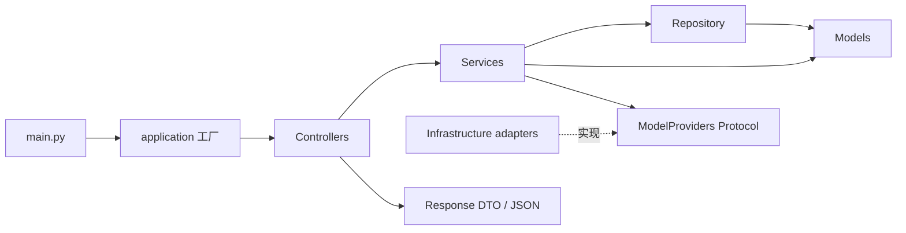
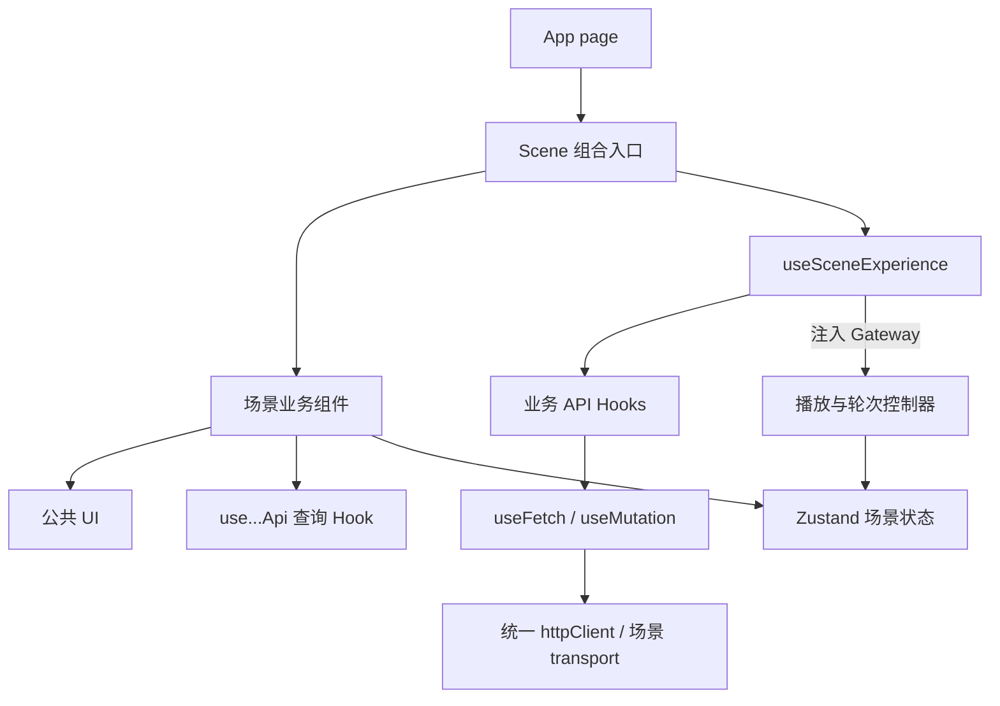

# 工程架构与维护约定

更新时间：2026-10-27。此文描述实际代码结构，不增加原需求范围。

## 后端：面向 REST API 的 MVC + Service / Repository 分层

后端不渲染 HTML，因此 MVC 的 View 由响应 DTO 和 JSON 序列化承担，页面视图由 Next.js 负责。不为了凑目录加入模板引擎。

```text
apps/api/app/
├── main.py                     # 仅导出 ASGI app，5 行
├── application.py              # 应用工厂、依赖组装、生命周期与异常映射
├── controllers/
│   ├── http.py                 # HTTP 输入/输出、文件读取边界
│   ├── realtime.py             # WebSocket 协议与连接生命周期
│   └── dependencies.py         # 请求级依赖入口
├── services/
│   ├── session_service.py      # 会话用例、播放确认、关闭与过期清理
│   ├── interaction_service.py  # STT → LLM → TTS、取消和并发控制
│   ├── events.py               # 带轮次的事件发布
│   └── contracts.py            # 模型服务端口 Protocol
├── repositories/
│   └── session_repository.py   # 内存存储、查找、认证、过期与创建限额
├── models/
│   ├── session.py              # 回合、取消、历史提交的领域状态
│   ├── scene.py                # 角色指令、枚举、剧情约束
│   ├── requests.py             # 入参 DTO
│   └── responses.py            # 出参 DTO，注册为 response_model
├── infrastructure/
│   └── providers.py            # OpenRouter、兼容语音服务、本地语音适配
└── core/
    ├── config.py               # 环境/只读 JSON 配置
    ├── container.py            # 类型明确的服务容器
    └── errors.py               # 不依赖 HTTP 框架的错误
```



约定：路由不直接调用模型；业务层不导入 FastAPI/Starlette；存储不直接创建 HTTP 响应；Provider 不写 UI 状态。可预期错误由 BusinessError 携带稳定 code，应用边界映射成 HTTP 状态。模型错误不把上游响应体、凭证、用户录音输出到日志。

增加一个接口：先定义 request/response DTO，再在服务中实现用例，最后在 controller 中接入并声明 response_model。更换存储时替换 repository，不改语音编排。更换厂商时修改 infrastructure 的适配，通过 ModelProviders 的契约测试。

仍使用单进程内存会话；这份拆分为维护提供边界，不表示已经具备分布式会话能力。模型适配接口是当前代码的可测试边界，不实现运行时插件市场。

## 前端：App 页面 → Feature → Hook → Service

参考了用户指定 AlphaHouseAI-front 的 `services/index.ts → hooks / module / api` 组织方式。没有复制其鉴权、监控或其他业务逻辑。

```text
apps/web/src/
├── app/
│   ├── page.tsx                # 路由页面，仅渲染 Scene
│   └── globals.css             # 统一场景样式与响应式布局
├── features/scene/
│   ├── scene.tsx               # 30 行，仅组合本业务组件
│   ├── components/
│   │   ├── scene-header.tsx
│   │   ├── scene-atmosphere.tsx
│   │   ├── character-stage.tsx
│   │   ├── photo-card.tsx
│   │   ├── conversation-panel.tsx
│   │   ├── subtitle-panel.tsx
│   │   ├── topic-suggestions.tsx
│   │   ├── composer.tsx
│   │   ├── error-feedback.tsx
│   │   ├── interaction-footer.tsx
│   │   ├── entry-overlay.tsx
│   │   └── experience-dialog.tsx
│   ├── hooks/use-scene-experience.ts
│   ├── model/                  # Zustand、轮次门、Mock 台词、展示标签
│   └── runtime/scene-controller.ts
├── components/ui/              # 不依赖本业务的公共 UI
│   ├── icon.tsx
│   ├── icon-button.tsx
│   ├── toggle.tsx
│   └── dialog.tsx              # Escape、焦点圈定与焦点恢复
└── services/
    ├── index.ts                # 对业务暴露 Hook 与类型
    ├── http-client.ts          # fetch、超时、取消、错误、JSON/Blob
    ├── hooks.ts                # useFetch / useMutation
    ├── api/path.ts             # 路径集中管理
    └── module/
        ├── scene.ts            # use...Api 业务 Hook 与 Gateway 组装
        ├── scene.types.ts      # 会话/请求 DTO 与运行时端口
        └── scene.transport.ts  # 纯请求函数和 WebSocket 创建
```

普通 GET 使用 `useFetch`（SWR）；有副作用的操作使用 `useMutation`（SWRMutation），仅显式 trigger 时执行。业务代码通过 `useCreateSessionApi`、`useSendTextApi`、`useUploadAudioApi`、`useLoadAudioApi`、`useCloseSessionApi` 和 `useBackendHealthApi` 调用接口。

录放音控制不是 React 渲染职责：`useSceneExperience` 在顶层合法调用这些 Hook，组装 SceneGateway 后注入 SceneController。控制器只协调会话、音频和轮次，不能直接 fetch 或创建 WebSocket。WebSocket 的生命周期与控制消息属于连接通道，不伪装成轮询 GET。Mock 音频也经相同加载端口，便于验证取消行为。



约定：

- 当前场景专属展示留在 `features/scene/components`，不要提前抽成通用“万能组件”。
- 无场景含义、可独立复用的交互控件才进入 `components/ui`；它们不能导入 scene store 或 API。
- 页面和展示组件不写 URL、不发请求、不管理 API 密钥。仅服务层可构造网络请求。
- 大 Blob、MediaRecorder、Audio、AbortController 放在运行时控制器中，不进 Zustand。
- 小组件按 selector 订阅需要的状态，避免整页每个状态变化都重渲染。
- 新增接口先在 ApiPath 和 DTO 中登记，再加 transport 与业务 Hook，最后在业务 Hook/组件接入。
- 保留用户要求的输入框无额外 focus 边框；按钮仍有键盘焦点提示。

## 本地和 CI 检查

```bash
corepack pnpm format:check
corepack pnpm lint
corepack pnpm typecheck
corepack pnpm test
corepack pnpm build

cd apps/api
uv run --frozen ruff check app tests ../../scripts
uv run --frozen ruff format --check app tests ../../scripts
uv run --frozen pytest -q
```

前端架构测试禁止业务 UI/运行时直接 fetch、构造 WebSocket 或绕过 Hook 导入底层 transport；公共 UI 不能依赖场景/API。后端架构测试禁止 main.py 承载函数实现，并禁止业务层导入 Web 框架。它们与打断、鉴权、语音解码测试一起运行。

本次验证：9 项前端测试、15 项本地后端测试；未安装 local extra 的 CI 会跳过 1 项真实音频解码依赖测试，其余仍执行。真实 OpenRouter、Vercel/服务器和真机的待验收项不因架构测试通过而自动完成。

## TSX、ESLint 与编辑器

- ESLint 10 + 与 Next.js 同版本的 eslint-config-next：使用官方 core-web-vitals、TypeScript 与 React Hooks 规则；执行时 `--max-warnings 0`。
- Prettier 统一排版；eslint-config-prettier 关闭双方冲突的排版规则，不关闭类型或 Hook 检查。
- TypeScript 的 `strict` 与 `tsc --noEmit` 检查真实类型问题；ESLint 不能替代类型检查。
- `.vscode/settings.json` 指定 monorepo 的前端工作目录和项目 TypeScript SDK，推荐从仓库根目录打开项目；保存时执行 ESLint 修复和 Prettier 格式化。
- 如果编辑器仍显示已经修复的旧诊断，执行 `TypeScript: Select TypeScript Version → Use Workspace Version`，再执行 `TypeScript: Restart TS Server` 与 `ESLint: Restart ESLint Server`。不要通过关闭校验或添加全局 ts-ignore 处理。

统一验证命令为 `corepack pnpm check`；自动修复用 `corepack pnpm lint:fix`，格式化用 `corepack pnpm format`。Node.js 使用22.13+的22系列或24+，CI与Vercel配置使用22系列最新补丁版。

已修复实际扫描出的 render 阶段 ref 写入、缺失 Hook 依赖、原生首页链接、图片组件和默认导出规范问题。ESLint、TypeScript、格式、单元测试和生产构建均是独立的交付检查，不用“格式统一”代替功能验证。
