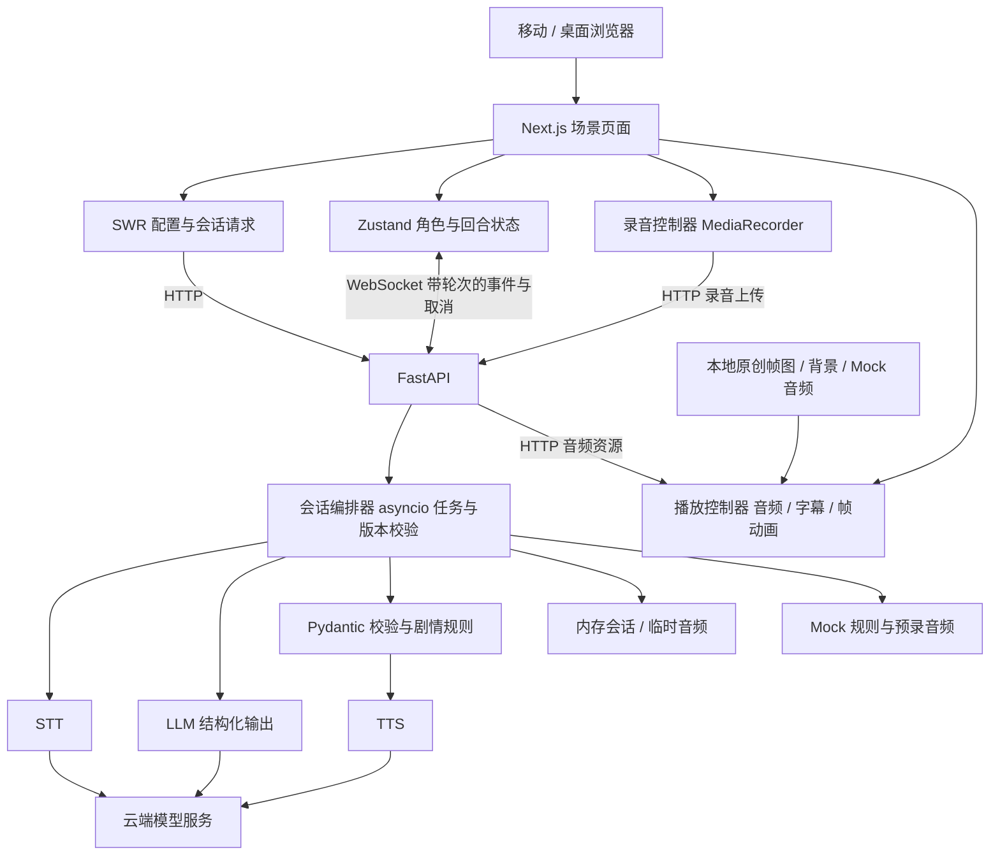
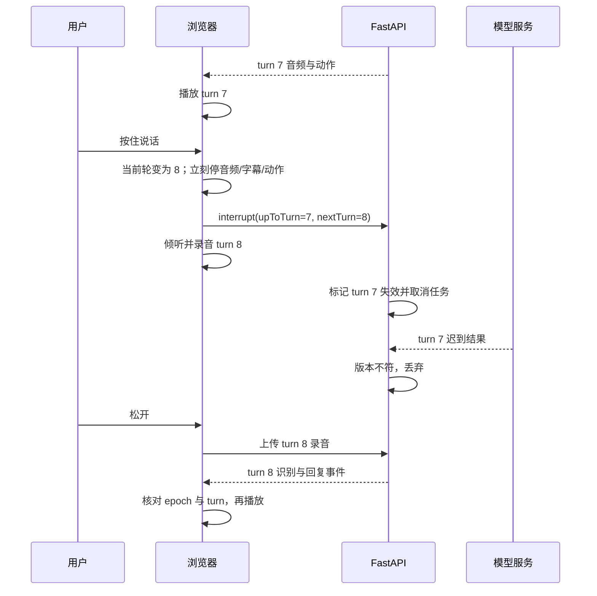

# 实时角色互动 MVP：技术可行性评估与执行方案

评估日期：2026-10-26。当前交付仅为方案，不包含业务代码，也未实际部署或运行候选开源仓库。

需求依据：工作区内《0912-candidate(1).pdf》，共 6 页。本文把其中的项目要求作为评估对象；不会执行文档中与当前“先分析、不写代码”请求无关的操作。页码均指 PDF 实际页码。

## 1. 结论与建议

**技术上可实现。建议交付一个移动网页优先、单成年原创角色、单场景、连续 3–5 分钟互动的 MVP。** 最值得投入的是打断一致性、角色状态和语音播放闭环，最大的风险是异步旧响应复活与移动浏览器录放音兼容，而不是模型训练。

建议默认技术路线：

- 前端：Next.js App Router + TypeScript + SWR + Zustand + Tailwind CSS（按用户所写 tailwindccc 理解为 Tailwind CSS）。
- 后端：Python + FastAPI + asyncio + Pydantic；调用现成云端 STT、LLM、TTS，不运行本地大模型。
- 交互：按住说话，按下时立即打断角色；文字输入同样能开始新一轮。
- 多模态：**只选序列帧角色动画**，搭配情绪贴图、姿态与背景变化；不做运行时生成图片/视频，不要求 Live2D 或 3D。
- 传输：HTTP 录音上传 + WebSocket 控制与事件 + HTTP 音频文件播放。首版一次生成一个短回复，不做音频分片拼接和逐字字幕。
- 工程：单 Git 仓库 monorepo，pnpm 管理前端 workspace，uv 管理 Python；Docker Compose 编排本地服务。
- 演示：真实模型模式 + 默认免密钥 Mock 模式，二者经过同一角色状态机与播放控制器。

开源复用优先，但不承诺已经存在“一键覆盖全部验收”的项目。候选中 Open-LLM-VTuber 最接近角色语音互动，LiveKit starter 最接近 Next.js 语音前端。**先用最多 4 个有效工时验证是否可直接改造；达到门槛就复用，不再另造同等模块。** 若不满足，采用上述轻量路线，复用成熟库，只实现需求特有的场景、协议和取消逻辑。已有项目不等于无需开发，关键是剩余改造成本是否更低。

对一名熟悉 React/Python、能使用 AI 工具、已有模型账号的开发者，轻量路线预计 **44–60 个有效工时**；72 小时提交窗口可争取完成，但属于紧凑交付，不能理解成稳定保证。如果需要临时学习音频工程或制作高品质角色，建议 5–8 个工作日。本文估算不等于已经验证的性能或报价。

## 2. 必做、排除与验收映射

### 2.1 只实现以下必做项

| 编号 | 原文要求与页码 | 最小实现 | 可观察的验收结果 |
|---|---|---|---|
| R01 | 场景角色为主体，移动端优先，桌面正常（p1） | 全屏咖啡馆背景、角色、单块当前字幕、底部输入区 | 主界面不是消息列表；手机输入键盘不遮挡核心操作 |
| R02 | 待机、倾听、思考、说话四状态（p1） | 每个状态对应可辨认画面和状态文案 | 不靠调试面板也能看出角色在做什么 |
| R03 | 文字、麦克风、语音回复与字幕，多轮（p1–2） | 文字发送；按住录音；STT→LLM→TTS；会话内上下文 | 文字和真实语音路径均成功，多轮状态连续 |
| R04 | 说话中开始新语音并打断，旧内容全部失效（p2） | 本地立即停播；轮次版本隔离；后端取消任务 | 旧音频、未播放字幕/动作、迟到响应均不复活 |
| R05 | 结构化角色/场景指令（p2） | 有限枚举 JSON，后端校验，前端映射资源 | 模型不能注入任意资源 URL 或脚本 |
| R06 | ≥3 情绪、≥2 非说话动作/视觉状态（p2） | 平静/好奇/难过；看窗外/递出照片 | 三种表情视觉可辨，两个动作与说话动画不同 |
| R07 | ≥1 环境/镜头变化，≥1 对话触发视觉事件（p2） | 谈到雨时切换雨窗环境；谈到摄影/照片时递出照片并展开照片卡 | 通过当前输入和剧情节点触发；不是固定时间播放 |
| R08 | 至少一种多模态能力（p3） | 原创角色序列帧动画，包含说话循环及动作序列 | 真实播放帧序列，不能仅用静态立绘加 CSS 位移冒充 |
| R09 | 前后端和模型完整闭环、状态连续（p3） | FastAPI 调用真实服务；内存保持当前会话 | API 密钥由服务端持有；真实输入得到模型语音回复 |
| R10 | 超时、断线、音频/媒体失败有反馈和恢复（p3） | 超时提示、重新发送、重建会话、播放重试/文字保留、动画静态降级 | 不会无限“思考中”；失败后可以继续操作 |
| R11 | 无私人 API 密钥也能体验（p3–4） | 本地规则驱动 Mock + 仓库内录制音频和序列帧 | 未配置任何云密钥即可体验多轮、打断、剧情事件和失败案例 |
| R12 | 源码、启动说明、录屏、README、AI_USAGE（p4–6） | 见交付清单 | 清洁环境启动和 3–5 分钟录屏可复现 |

三个边界必须明确：基础字幕同步是必做，逐字流式字幕不是；基础故障恢复是必做，自动重连后无损会话恢复不是；停止旧字幕/动作是必做，复杂动作优先级系统不是。

### 2.2 明确不实现

以下是文档 p5 明确“不需要完成”的内容，**本期全部排除**：账号/注册、支付/订阅/虚拟货币、管理后台、角色市场/社区、原生 iOS/Android、训练/微调、多角色/多章节/完整游戏、大规模生产基础设施。

以下是 p3–4 的可选扩展，本期也不实现：自动 VAD 与自然插话、附和词判定、专项回声消除、逐字流式字幕、延迟观测页面、无损重连恢复、口型同步、眨眼呼吸视线系统、复杂动作混合、实时音频驱动动作、通用角色配置平台、视频系统、生成式媒体、运行时多 Provider 切换、完整事件追踪/回放平台。

取消令牌和轮次校验虽然出现在可选工程能力附近，但为满足 R04 必须做**局部最小实现**，不延伸为通用取消框架。Mock 所需的离线样例也不扩展成通用回放平台。

README 仍需写“两周后如何演进”，但只写设想，不实施这些扩展。

## 3. 场景与素材方案

采用文档允许的 Mira 种子：26 岁原创旅行摄影师，暴雨后的咖啡馆，琥珀色雨衣、银色星星发夹。只安排一段短故事，不制作分支树。

| 对话内容/状态 | 行为 | 使用素材 |
|---|---|---|
| 等待输入 | 平静待机 | 平静立绘/待机帧 |
| 用户按住麦克风 | 面向用户，倾听提示 | 倾听姿态 |
| 请求处理中 | 思考画面 | 思考姿态 |
| 播放回复 | 对应情绪 + 说话循环 | 说话序列帧，不要求音素口型 |
| 用户询问雨/窗外 | 看窗外，环境切为雨窗 | 动作帧 + 第二张背景 |
| 用户询问摄影/照片 | 好奇或难过，递出照片，显示照片卡 | 递照片动作帧 + 照片素材 |
| 用户打断 | 立刻退出说话与尚未完成的演出 | 切回倾听姿态 |

素材最低清单：2 张背景、3 种情绪角色图、倾听/思考姿态、1 组说话循环（如 4–6 帧）、看窗与递照片各 1 组动作帧（如各 4–8 帧）、1 张原创照片卡、6–10 条离线演示语音。可以共用身体图层降低制作量，最终数量以视觉可辨和演示完整为准。

先用授权占位素材跑通，第二天前替换为原创成年角色。图片离线自制或 AI 辅助制作，运行时无需图像 API。AI 生成素材常出现脸部、手部、服装不一致，必须人工逐帧检查。README 记录来源、生成工具和许可；不直接拿候选仓库默认人物当作原创角色。

如果序列帧资源制作遇到阻塞，优先简化动作与画风，不临时增加 Live2D 建模或视频生成路线。

## 4. GitHub 项目复用评估

核查方式：2026-10-26 查阅官方仓库、README、许可证与官方文档。以下为文档级判断，未 clone、实测或审计完整依赖；实施前固定 commit 并复核实际代码、许可证和素材来源。不依据 star 数决定质量。

| 项目 | 已有能力 | 与本需求的缺口 | 本期决定 |
|---|---|---|---|
| [Open-LLM-VTuber](https://github.com/Open-LLM-VTuber/Open-LLM-VTuber) | 语音互动、打断、Live2D 角色；Python 后端 | 需验证移动页面、原创素材、剧情事件、免密钥演示、过期事件处理；现有前端并非目标 Next.js 栈 | 最接近完整体验，优先限时运行验证 |
| [LiveKit agent-starter-react](https://github.com/livekit-examples/agent-starter-react) + [Agents](https://github.com/livekit/agents) | Next.js 语音前端模板与语音代理框架 | 需增加完整场景表演、剧情状态和 Mock；引入 LiveKit 服务/云配置 | 若已有 LiveKit 经验和账号，优先改造；否则不为按住说话额外引入媒体基础设施 |
| [Pipecat](https://github.com/pipecat-ai/pipecat) | Python 语音与多模态流水线框架 | 不含本题角色场景成品；仍要做前端与资源，需适配框架生命周期 | 更适合实时语音后续方向，本期默认不引入 |
| [TalkingHead](https://github.com/met4citizen/TalkingHead) | 浏览器 3D 角色和语音口型能力 | 仍缺语音识别、对话后端、剧情与 Mock；3D 资源增加成本 | 本题不要求 3D/口型，本期不选 |

许可事实：Open-LLM-VTuber 当前核查的[后端 LICENSE](https://github.com/Open-LLM-VTuber/Open-LLM-VTuber/blob/main/LICENSE)写明 MIT 且样例 Live2D 另有许可；其[前端 LICENSE](https://github.com/Open-LLM-VTuber/Open-LLM-VTuber-Web/blob/main/LICENSE)含额外商业使用限制。不能把整个产品笼统写成 MIT。LiveKit starter 的[许可证为 MIT](https://github.com/livekit-examples/agent-starter-react/blob/main/LICENSE)，Pipecat 的[许可证为 BSD-2-Clause](https://github.com/pipecat-ai/pipecat/blob/main/LICENSE)。代码、模型和素材授权必须分别核实。这里是选型记录，不替代针对实际使用方式的许可证审查。

### 4.1 4 小时复用决策门

1. 第 0–1 小时：确认评审是否接受基于开源二开。题面 p1 写“从零实现”，p4 又允许开源库；用户希望复用，因此可以评估，但直接 fork 整个成品是否符合出题方期待，仍有解释空间。未明确时采用开源组件复用、自行实现题目核心编排，并注明来源。
2. 第 1–3 小时：优先启动 Open-LLM-VTuber，使用自有服务配置验证语音、打断、移动访问和替换角色的工作量；已有 LiveKit 基础时改验 LiveKit starter，避免两个路线都深挖。
3. 第 3–4 小时：验证能否取消旧字幕/动作、增加一次对话事件、接入免密钥样例。评估授权和依赖体积，记录实际失败原因。
4. **复用门槛**：可运行、授权适合本次使用、核心模块无需重写、剩余改造估计 ≤32 小时。通过则复用既有链路，把精力放在差异需求；不强制把现成非 Next 前端迁移到 Next，因为用户将指定栈作为无合适成品时的偏好。
5. 未通过则停止复用探索，执行本文默认 Next.js + FastAPI 路线；不在剩余时间并行维护两套系统。

未发现经本次核查能直接证明满足全部 R01–R12 的成品，不能承诺“找到仓库即可交付”。复用省时幅度必须在上述验证后重估，不能直接扣减预算。

## 5. 默认架构与前后端职责



部署是同一主机上的 web、api 与轻量 HTTPS 反向代理；代理转发 /api、/ws、/audio 到 Python，其余交给 Next.js。无需 PostgreSQL、Redis、消息队列、Kubernetes、GPU 或对象存储。单 api 进程使用内存会话，不能直接横向扩容；重启会话丢失是本期明确限制。

### 5.1 前端可实践性

| 组件 | 职责 | 限制与注意事项 |
|---|---|---|
| Next.js | 页面壳、资源、移动布局；场景组件使用 Client Component | 麦克风、AudioContext 和动画都在浏览器；不把 SSR 当实时播放方案 |
| SWR | 读取场景配置/健康状态；useSWRMutation 创建会话等命令 | 不用普通 useSWR GET 驱动“生成回复”，避免焦点重验证触发重复请求 |
| Zustand | 当前 phase、emotion、action、scene、activeTurn、字幕与错误状态 | 不保存大音频 Blob；WebSocket 事件入库前先校验轮次 |
| Tailwind CSS | 安全区、输入区、响应式布局与基础反馈 | 帧动画由播放器执行，不用大量 React 高频 setState 逐帧渲染 |
| 播放控制器 | 音频、字幕、动作统一开始/停止；资源句柄清理 | Audio/AbortController/定时器保存在控制器或 ref，取消时同步清理 |

此职责分配与 [Next.js Client Component 官方说明](https://nextjs.org/docs/app/getting-started/server-and-client-components)、[SWR Mutation 官方说明](https://swr.vercel.app/docs/mutation)一致。具体依赖选实施当天兼容的稳定版本，固定 lockfile；不在方案阶段虚构未来版本号。

### 5.2 后端为何选 Python

FastAPI 支持 [WebSocket](https://fastapi.tiangolo.com/advanced/websockets/)，Pydantic 适合约束指令，asyncio 可管理会话与可取消任务；语音模型生态也方便接入。负载主要是外部网络 IO，本题无 Go/Rust 才能解决的性能瓶颈。

Node.js/TypeScript 同样可行，若实施者只熟悉 TS，使用 Node 可降低跨语言成本；但按当前用户偏好及语音集成需求，默认选 Python，不再加入第三种后端语言。Python 中避免阻塞式 SDK 卡住事件循环，优先异步客户端；必须使用同步调用时放入受控线程，并继续依靠版本校验丢弃取消后的结果。

会话内只保存最近若干轮上下文、单角色剧情状态和当前轮任务。原始录音处理后删除，生成音频与会话设置短 TTL（建议 30 分钟空闲回收），退出时释放资源，不构建长期记忆数据库。

## 6. 语音、字幕与模型方案

### 6.1 选组合语音而非全双工实时模型

一次完整流程：按下话筒→停止角色→录音→松开→上传→STT→校验轮次→LLM 生成短回复和指令→校验→TTS→返回音频就绪事件→播放并显示该条字幕→结束回待机。

文档明确允许 STT/LLM/TTS，也允许按住说话；因此这条路线符合要求。录音期间暂停角色语音，自然降低扬声器串入录音的风险，不额外开发回声消除。浏览器默认音频处理可使用，但不承诺特殊环境下完全无回声。

首版限制单次输入最长 20 秒、单条回复通常 1–2 句、约 30–80 个汉字，避免长篇 TTS 阻塞。等待期间展示思考态，超过阶段超时给出可操作反馈。

建议初始接入同一云平台以减少账号与网络变量：百炼短录音识别、通义文本模型和非实时 TTS。候选可从 Qwen-ASR Flash、Qwen 快速文本模型、Qwen-TTS 的可用版本中确定；**具体 model ID、音色、地域、账号权限须在第一阶段调用验证后固定**。不做跨 Provider 插件系统。官方可查 [ASR 接口](https://help.aliyun.com/zh/model-studio/qwen-asr-api-reference)、[TTS 接口](https://help.aliyun.com/zh/model-studio/qwen-tts-api)、[价格](https://help.aliyun.com/zh/model-studio/model-pricing)。不能把不同产品的兼容接口、base URL 和计费单位混用。

### 6.2 浏览器约束必须提前实测

- 麦克风页面使用 HTTPS 或受信任本机环境；手机通过电脑局域网 HTTP 地址访问不应作为正式语音验收方式。
- MediaRecorder 使用 isTypeSupported 选择录音类型，例如支持时选 WebM/Opus，否则尝试 MP4；后端通过 FFmpeg 统一到 STT 所需格式。不能假定所有浏览器输出相同编码。[MDN 类型探测说明](https://developer.mozilla.org/en-US/docs/Web/API/MediaRecorder/isTypeSupported_static)。
- 首屏设置“进入场景并启用声音”，通过用户操作解锁音频；对 play() 被拒绝显示“点击播放”。不能只在桌面 Chrome 验证。
- 移动按住交互处理 pointerup、pointercancel、失焦和触摸滚动，录音被系统打断时退出倾听并提示重试。
- 实测至少 iOS Safari、Android Chrome、桌面 Chrome；后台切换不支持无缝继续，返回后允许重新开始会话。

### 6.3 字幕同步与延迟目标

字幕与同一条音频关联：确认播放开始后显示全文，播放结束后可保留已播内容；打断立即清空当前未完成字幕和未来事件。这里只做句级/回复级字幕同步，不承诺逐字对齐。

规划目标：本地打断到静音 ≤100ms；短录音上传、STT、LLM、TTS 到可播放合计争取 2–5 秒。二者均是工程目标而非需求硬指标或实测结论，公网与模型负载可能超出。建议 STT/LLM/TTS 各设约 10–15 秒上限，整轮总上限 30 秒，超时失效并提示重试；实施时以实测调整。

## 7. 打断一致性：本项目最关键的实现

只停止播放器不足以合格：旧 TTS 可能晚到，旧动画回调也可能把倾听态改回待机。必须同时控制本地、服务端和每个异步回调。

采用 sessionId + sessionEpoch + turnId。客户端在任何新文字输入或按下话筒时先同步递增 turnId，立即使旧轮失效；服务端只接受当前 epoch 内递增的轮次，拒绝重复/旧请求。重新创建会话更换 epoch，旧连接事件也会失效。



取消顺序：

1. 同步更新前端当前轮；停止 AudioBufferSource/HTMLAudio；暂停并清理资源。
2. 清除字幕、动画队列、定时器、未完成素材请求；切换倾听。
3. abort 当前 HTTP 请求，发送后端 interrupt；不等待网络确认才静音。
4. 后端给会话任务加锁更新轮次，取消旧 asyncio Task；每个 await 后、状态提交前再核对轮次。
5. 每条事件、音频下载完成、decodeAudioData、play promise、ended/onerror 和动画结束回调，都携带/捕获轮次，失效就直接返回。
6. 上游不支持真正取消时允许请求在远端结束，但结果不得发布或写回场景；可能仍计费，不能宣称全链路绝对节费。

用户按住后取消录音也不恢复旧回复，回到待机，避免已打断内容重新说话。快速 A/B/C 连续输入采用 latest-wins，只允许最后一轮有播放资格。断线时本地停止并失效当前轮，重新进入场景新建会话，不做旧任务重放。

剧情状态与播放状态分开：LLM 结果先暂存，不在收到半截输出时提交剧情；有效轮次的受控事件实际开始后才提交对应剧情节点。已展示的照片可以保留，未触发的动作必须取消。历史记录对已播/部分播/取消回复做明确标记，避免模型把未播放的长回复当作用户已经听过。

## 8. 结构化指令与接口契约

以下是设计示例，不是已实现接口。

```json
{
  "text": "这是我在旅途中拍的一张照片，你想看看吗？",
  "emotion": "curious",
  "action": "offer_photo",
  "environment": "cafe_night",
  "event": "reveal_photo"
}
```

模型只产出上面的有限字段。sessionId/epoch/turnId 由程序补充，禁止相信模型生成的标识。emotion 限 calm/curious/sad，action 限 none/look_window/offer_photo，environment 限已存在的背景，event 限 none/reveal_photo。资源 ID 只映射本地清单，不让模型输出可执行代码、CSS 或任意文件路径。

LLM 结构化输出经 Pydantic 校验。格式错误时允许一次限时格式修复；仍失败则返回中性短句、无事件，正常反馈故障，不能直接执行未校验指令。超长输入/输出做截断或拒绝。

对话驱动采用“模型建议 + 服务端规则约束”：照片事件必须结合当前用户输入涉及摄影/照片或已经进入对应节点；雨窗变化同理。节点按会话记录，避免无意重复刷屏。Mock 使用相同条件规则，不用进入页面 N 秒后自动触发。LLM 故障回退的预设句必须标明降级，不能伪装为真实模型成功。

建议接口：

| 方式/路径 | 用途 |
|---|---|
| GET /api/health | 最小健康状态 |
| GET /api/scene | 单场景资源配置及 real/mock 标识 |
| POST /api/sessions | 创建匿名短会话，返回随机 session 标识与 epoch |
| POST /api/sessions/{id}/turns/text | 提交文字与 turnId，校验后启动任务并返回接受结果 |
| POST /api/sessions/{id}/turns/audio | multipart 上传录音、turnId、实际 MIME 类型 |
| WS /ws/sessions/{id} | 下发 state/recognized/reply.ready/error；接收 interrupt |
| GET /audio/{opaqueId} | 获取当前会话允许访问的临时音频 |

回复事件至少包含 sessionId、epoch、turnId、eventId、type、payload，重复 eventId 去重。先连 WebSocket 再开放发送；断开时禁用新请求并提示恢复。取消事件与 HTTP 请求跨通道可能乱序，因此后端按轮次判断，不能按抵达时间认定最新。

限制匿名会话输入大小、录音时长、每轮并发和请求频率；标识随机且不要写入公开日志，临时音频检查会话关联。只做保护演示必要的限制，不开发账户系统。云密钥仅在 API 环境变量中，Mock 资源可以公开。

## 9. Monorepo 与启动方式

```text
CharacterInteraction/
├── apps/
│   ├── web/                    # Next.js + Tailwind + SWR + Zustand
│   └── api/                    # FastAPI + pyproject.toml + uv.lock
├── packages/
│   ├── contracts/              # JSON Schema、事件类型与样例
│   └── scene-assets/           # 原创帧图/背景/Mock音频与来源清单
├── fixtures/                   # Mock规则、超时/迟到/坏音频样例
├── infra/                      # Dockerfile、Compose、HTTPS代理配置
├── docs/                       # 架构、验收、方案
├── pnpm-workspace.yaml
├── pnpm-lock.yaml
├── package.json                # 根目录开发/启动入口
├── .env.example
├── README.md
└── AI_USAGE.md
```

monorepo 是同仓协作，不要求 pnpm 管理 Python 包。根脚本调度 web 与 uv 启动 api，API 依赖留在 Python 环境，契约通过 JSON Schema 和代表性样例检查字段一致性，不共享不可跨语言使用的运行时代码。

交付目标：已安装 Docker 的环境执行 `docker compose -f infra/compose.yml up --build` 默认启动 Mock；配置服务端 .env 后切换真实模式。前端构建包含固定素材，不在初次启动时下载大模型。真实模式缺密钥应明确提示，不能悄悄宣称真实成功。首次构建依赖网络和机器性能，需在清洁环境计时，验证完整操作 ≤15 分钟；不满足就给出准确启动步骤和已知限制。

公网演示用同一主机的 HTTPS/WSS。若不部署，文档允许清晰本地启动，但手机语音验收仍要提供可信 HTTPS 路径。Next.js 仅负责前端，常驻 WebSocket 放在 Python 服务，不依赖短生命周期函数托管后端。

## 10. 难点、风险及停止扩张条件

| 难点 | 风险级别 | 处理办法 | 验证/止损 |
|---|---|---|---|
| 旧轮次音频/动画复活 | 高 | 立即本地取消 + 全回调版本校验 + 服务端任务取消 | 人为延迟旧 TTS/解码/动画回调，确认全部被丢弃 |
| iOS/Android 录放音与权限 | 高 | HTTPS、能力探测、音频解锁、统一转码 | 第一阶段真机试录试播；失败先修基础兼容 |
| 原创角色一致性与动画辨识 | 中高 | 少量分层帧图、固定构图、人工检查 | 不能只有静态图；第二天前锁定素材，不增加复杂画风 |
| 模型输出无法驱动画面 | 中 | 枚举 Schema、事件白名单、剧情规则 | 给定问题可触发明确事件；坏 JSON 有回退 |
| 多服务累计延迟 | 中 | 短回复、短录音、明确思考态 | 超时有退出路径；不临时换为全双工架构 |
| 第三方账号/地域不可用 | 中高 | 开始即实测三个接口；Mock独立交付 | 真服务不通必须报告阻塞，不能用Mock冒充闭环 |
| 开源改造反而更慢 | 中 | 4小时门槛、明确复用边界 | 不通过即选定轻量路线，不持续试新框架 |
| 断线/媒体失败导致卡死 | 中 | 错误态、手动重建会话、静态画面与文字保留 | 至少演示一种故障；失败后仍可发起下一轮 |

TTS 失败时保留文字可用于恢复体验，但不算语音回复验收通过；所有帧图加载失败后的静态画面也只是降级，正常路径仍必须播放动画。可选项不能被用来代替必做项。

## 11. 工期与执行阶段

下面为轻量路线总工作量，包含初期复用判断；不是让单人连续工作 60 小时。72 小时是提交窗口，睡眠和等待素材需纳入日历安排。直接复用通过后按真实改造情况重排，不叠加两份开发工时。

| 阶段 | 有效工时 | 产物和出口条件 |
|---|---:|---|
| A. 范围、复用、真机/服务验证 | 4–6h | 选定唯一路线；真机能录放音；STT/LLM/TTS各成功一次 |
| B. monorepo、契约与Mock闭环 | 6–8h | 默认免密钥启动，文字输入→状态→语音字幕→待机 |
| C. 真实语音与多轮 | 8–10h | 真实文字和麦克风均可多轮，阶段错误能恢复 |
| D. 打断与竞态 | 8–10h | 说话中按住新语音；连续输入/旧请求迟到不会复活 |
| E. 原创素材与剧情演出 | 8–12h | 3情绪、2非说话动作、环境变化、对话事件、序列帧完成 |
| F. 真机验收、交付与录屏 | 6–8h | 清洁启动、失败场景、README/AI_USAGE和录屏 |
| G. 风险缓冲 | 4–6h | 仅修必做缺陷 |
| **总计** | **44–60h** | 不含复杂建模、商业授权等待或额外产品功能 |

建议日历：前 24 小时锁定路线、资源方案及 Mock 闭环；24–48 小时完成真实语音和打断；48–60 小时补齐演出并真机验证；最后 12 小时冻结范围、修缺陷、录屏和整理交付。素材可以与主链路穿插制作，但总人时仍需计入。

阶段 A 失败时先修服务与浏览器基础，不开始堆页面；阶段 D 未过不增加任何视觉可选效果；最后 12 小时不换框架、不新增服务。若剩余工时不够覆盖必做项，应明确列出未完成项与影响，不因 PDF 允许说明问题而把缺项宣称为完成。

## 12. 成本模型

### 12.1 开发与一次性费用（人民币，预算假设）

| 项目 | 估算 | 说明 |
|---|---:|---|
| 人力 | 44–60h | 以内部/外包小时成本 r 计算：44r–60r |
| 人力示例 | ¥13,200–18,000 | 仅假设 r=¥300/h，用于比较，不是市场报价 |
| 自制/AI辅助素材 | ¥0–500现金 + 已计入的制作人时 | 取决于已有工具额度；人工高品质定制另算且本期不建议 |
| API联调预留 | ¥100–300 | 预算上限预留，不是预计一定用完的实际账单 |
| 演示主机/域名 | ¥0–200预算 | 优先已有资源/本地；新购以实际服务报价为准 |

现金预算可先预留 **¥100–1,000，不含人工与商业授权**。无需买 GPU。若 fork 项目需要商业授权，单列确认，不把授权费用默认为 0。

### 12.2 单次会话和月度模型成本

采用参数化估算，避免把未固定地域/model 的官方价格写成已锁定报价：

`单会话成本 = 输入token/100万×Pi + 输出token/100万×Po + STT分钟×Ps + TTS字符/万×Pt`

假设一段 5 分钟体验：8 轮、用户录音累计 2 分钟、角色约 500 汉字、上下文累积后输入 12,000 token、输出 1,000 token（均是容量假设，不是实测）。假设预算单价 Pi=¥2/百万输入token、Po=¥8/百万输出token、Ps=¥0.1/分钟、Pt=¥2/万字符，则：

- 文本：0.012×2 + 0.001×8 = ¥0.032。
- 识别：2×0.1 = ¥0.20。
- 合成：500/10,000×2 = ¥0.10。
- 合计约 **¥0.332/会话**；按重试、被取消但计费的请求和调试留 2–3 倍余量，约 ¥0.66–1/会话。

上述单价是**测算输入，非当前产品报价**；如实际服务按秒、音频 token 或其他单位计费，先按其官方规则转换再代入。正式执行在[官方价格页](https://help.aliyun.com/zh/model-studio/model-pricing)选择同一地域、具体模型和音色，记录日期并替换四个参数，不能混用国际/中国地域单价，也不依赖免费额度保证交付。

按上述假设：100 次联调约 ¥33.2 原始调用成本，预留 ¥66–100；每月 1,000 次 5 分钟会话约 ¥332 原始调用成本，含调用余量约 ¥664–996，再加主机/带宽。这里只是可复算预算，不是容量压测结论。Mock 不产生模型费用。真人测试与视觉资源制作的人力远高于本题模型调用成本。

## 13. 验收脚本与交付清单

### 13.1 必做验收（人工为主，补最少竞态验证）

| 用例 | 操作 | 通过条件 |
|---|---|---|
| T01 无密钥 | 清空服务密钥，启动Mock | 能进入场景、输入、听预录语音、看字幕和演出 |
| T02 真实多轮 | 文字→语音→文字交替至少5轮 | 服务端真实调用成功，上下文和角色状态连续 |
| T03 语音打断 | 角色说话时按住话筒并说新内容 | 原语音立即停；进入倾听；新一轮正常回复 |
| T04 迟到竞态 | 延迟A回复，提交B/C；延迟旧音频解码和ended回调 | 只有C可以播放/改状态；A/B字幕与动作不出现 |
| T05 情绪动作 | 输入相关问题 | 3情绪、看窗/递照片可辨认，非说话状态明显 |
| T06 对话触发 | 先无关交流，再问雨/照片 | 只有相关对话触发环境/照片事件，不靠固定计时 |
| T07 故障 | 模型超时、断开WS、坏音频/坏帧图分别验证 | 有明确反馈和可用恢复入口；无永久等待 |
| T08 权限与真机 | 拒绝麦克风；iOS/Android录放音；桌面输入 | 拒绝时可转文字；真实语音可用；输入区不被遮住 |
| T09 清洁启动 | 无本地缓存的新环境按README操作 | 默认Mock可用，完整启动步骤在15分钟内实测 |

用 fixtures 控制超时与迟到事件；最低限度做轮次隔离和取消后回调的定向检查，不建设完整测试平台。PDF把自动化测试列为可选，本期不把测试数量当交付指标。

### 13.2 3–5 分钟录屏安排

0:00–0:30 进入移动场景，展示四状态入口；0:30–1:30 文字与语音多轮；1:30–2:15 触发雨窗、情绪、看窗动作；2:15–3:00 触发递照片和帧动画；3:00–3:45 说话中成功打断并继续；3:45–4:30 展示一次失败与恢复，最后说明免密钥Mock入口。录屏尽量使用真实链路，Mock/故障注入必须显式标注。

### 13.3 最终需要交付的文件与说明

- 源码仓库，排除密钥和私人凭证，保留依赖锁文件与 .env.example。
- 可访问演示地址或清晰本地说明；一条命令启动/完整启动≤15分钟的实际记录。
- 3–5分钟录屏，覆盖互动、状态变化、打断、多模态、至少一种失败/降级。
- README：架构、主要模块、语音/打断、指令设计、模型/第三方与素材来源、技术取舍、已知问题、实际投入时间、两周演进设想。
- AI_USAGE.md：真实使用的AI工具、参与工作、人工验证结果、一个实际发现并修正AI错误的例子；不能预先编造“人工已经验证”。

完成标准是 R01–R12 均有证据，T01–T09 的相关路径通过；不是仅有漂亮页面或一段预录视频。真实模型和Mock都需要，二者用途不同。

## 14. 实施前仍需验证的事项

这些不阻塞当前方案，但决定开工后的第一阶段结果：候选开源项目实际运行和许可适配、出题方是否接受整项目二开、目标手机录音格式、云账号的地域与三个接口权限、原创素材质量、实际耗时与单价。本文没有将这些标记为已完成。

默认按单开发者、少量并发演示、中文互动、无持久化历史、已有Docker和云账号安排。若任一假设变化，先更新工期和成本，不增加与题目无关的产品功能。
